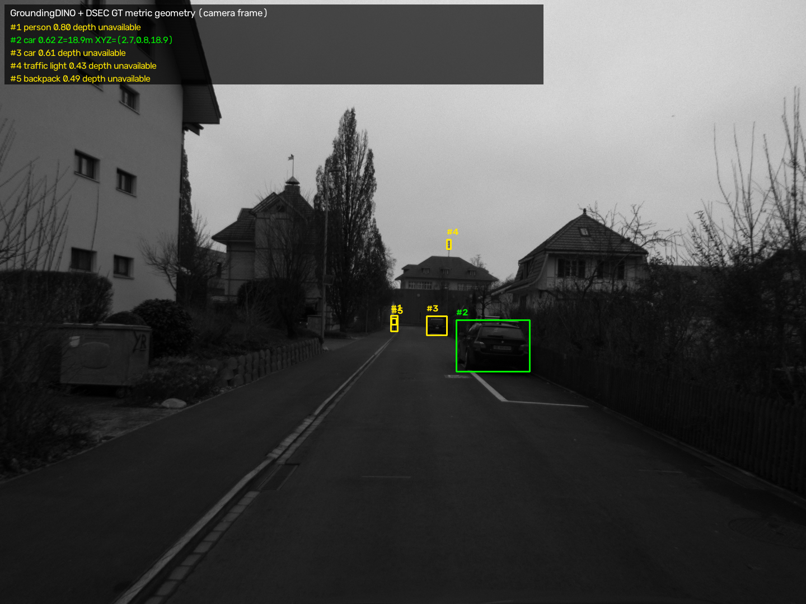
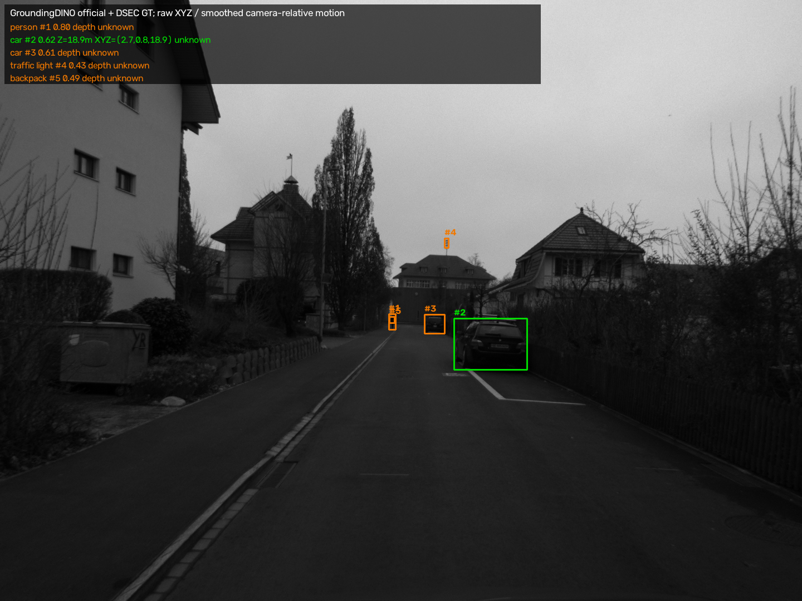

# Event4D：持久开放世界 4D 场景理解原型

这是一个面向双目事件视觉的研究原型。系统把开放词汇目标检测、米制三维定位、跨帧身份关联、对象记忆和语言查询串成一条可运行流程，并已在真实 DSEC 序列 `thun_00_a` 上完成验证。

当前主流程使用 DSEC 校正后的左目帧图像进行语义检测，使用数据集真值视差完成几何定位。事件流的读取与累积可视化已经验证，但尚未参与检测、深度估计或跟踪推理。



## 已完成的功能

- 使用官方 GroundingDINO Swin-T 模型完成文本提示目标检测；
- 根据 DSEC 标定和真值视差计算米制深度及相机坐标系 XYZ；
- 通过二维框、类别和三维位置进行跨帧目标关联；
- 为每个目标保存身份、位置、轨迹、速度和时间状态；
- 支持按类别、距离、运动状态、历史位置和目标编号查询；
- 输出检测叠加视频、俯视图视频、轨迹表和对象记忆；
- 提供 DSEC 下载、环境安装、单帧检查、完整运行和结果审查脚本。

## 真实运行结果

测试环境为 Windows、Python 3.13、CPU 推理。运行约 12 秒的 DSEC `thun_00_a` 序列，按时间戳选取 22 帧：

| 项目 | 结果 |
| --- | ---: |
| 处理帧数 | 22 |
| 检测次数 | 136 |
| 有效三维观测 | 54 |
| 目标轨迹编号 | 45 |
| 单个编号最多观测次数 | 17 |
| 最长有效三维轨迹 | 9 点 |

检测视频：[overlay.mp4](outputs/demo/overlay.mp4)  
俯视图视频：[bev.mp4](outputs/demo/bev.mp4)  
详细核对记录：[reports/审查记录.md](reports/审查记录.md)



## 处理流程

```text
DSEC 校正图像 ──> GroundingDINO 检测 ─┐
                                      ├─> 三维观测 ─> 目标关联 ─> 4D 对象记忆 ─> 查询与可视化
DSEC 真值视差 + 标定 ─> 深度与 XYZ ────┘

DSEC 左右事件流 ─> 读取与累积图检查（当前未接入主推理链）
```

## 目录结构

```text
event4d/                 核心 Python 模块
  adapters/              DSEC 数据读取
  semantics/             开放词汇检测
  geometry/              深度、反投影与 ESVO2 接口
  tracking/              跨帧目标关联
  memory/                对象记忆
  query/                 规则查询
  visualization/         检测图和俯视图
configs/                 系统配置
scripts/                 安装、下载、运行和审查脚本
tests/                   单元测试与回归测试
outputs/                 随仓库提供的示例结果
reports/                 项目审查记录
docs/                    标定与硬件说明
```

## 安装

在 Windows PowerShell 中进入项目目录：

```powershell
py -3.13 scripts\setup_environment.py
```

该脚本会创建 `.venv`、安装 `requirements.txt` 中的依赖，并获取官方 GroundingDINO 源码。项目使用 `transformers==4.49.0`，以兼容当前 GroundingDINO 实现。

检查环境：

```powershell
.\.venv\Scripts\python.exe scripts\check_environment.py
```

## 获取数据和模型

数据集和模型文件体积较大，不放入 GitHub 仓库。下载脚本支持断点续传和完整性检查：

```powershell
.\.venv\Scripts\python.exe scripts\download_demo_data.py
.\.venv\Scripts\python.exe scripts\download_models.py
```

数据来自 [DSEC 官方下载页](https://dsec.ifi.uzh.ch/dsec-datasets/download/)，包括 `thun_00_a` 的左右事件、左右校正图像、图像视差、标定和时间戳。模型为官方 [GroundingDINO](https://github.com/IDEA-Research/GroundingDINO) Swin-T 权重。

## 运行

先检查数据和单帧结果：

```powershell
.\.venv\Scripts\python.exe scripts\verify_dsec.py
.\.venv\Scripts\python.exe scripts\detect_one.py
```

运行完整演示：

```powershell
.\.venv\Scripts\python.exe scripts\run_dsec_demo.py --duration 12 --fps 2 --detector groundingdino
```

查询对象记忆：

```powershell
.\.venv\Scripts\python.exe scripts\query_demo.py outputs\demo\memory.jsonl --examples
.\.venv\Scripts\python.exe scripts\query_demo.py outputs\demo\memory.jsonl
```

运行测试：

```powershell
.\.venv\Scripts\python.exe -m unittest discover -s tests -v
```

当前共有 12 项测试，覆盖三维投影、目标关联、记忆查询、速度时间间隔、历史查询、空帧过期、事件索引边界和 ESVO2 导出检查。

## 结果文件

- `outputs/sanity/`：左右事件累积图、视差、深度、单帧检测与三维检测；
- `outputs/demo/overlay.mp4`：检测框、编号、深度和运动状态叠加视频；
- `outputs/demo/bev.mp4`：相机坐标系俯视图视频；
- `outputs/demo/tracks.csv`：逐帧轨迹表；
- `outputs/demo/memory.jsonl`：对象记忆；
- `outputs/demo/observations.jsonl`：完整观测记录；
- `outputs/demo/demo_summary.json`：运行配置和统计摘要；
- `outputs/demo/query_examples.txt`：查询示例。

## 当前边界

- DSEC `thun_00_a` 没有接入自车位姿，因此 XYZ、轨迹、径向运动和俯视图都位于校正后的左帧相机坐标系；相机运动也会反映在目标轨迹中。
- 当前几何来自 DSEC 真值视差，尚未验证事件双目深度估计。事件流只用于数据读取和累积图检查。
- 检测使用九类预设文本提示，尚未完成任意新类别发现和长期重识别实验。
- 检测框中央区域没有足够有效视差时，系统保留语义观测并将深度标为 `unknown`，不会伪造 XYZ。
- 当前统计用于说明系统已经跑通，不代表检测、深度或跟踪精度指标。

## 致谢与引用

本项目使用或参考了以下公开工作：

- [DSEC: A Stereo Event Camera Dataset for Driving Scenarios](https://dsec.ifi.uzh.ch/)
- [GroundingDINO](https://github.com/IDEA-Research/GroundingDINO)
- [ESVO2](https://github.com/NAIL-HNU/ESVO2)（仅提供接口与准备说明，尚未完成真实序列运行）

数据、模型和第三方项目分别遵循其原始许可与使用条款。本仓库用于研究原型展示和复现实验。
